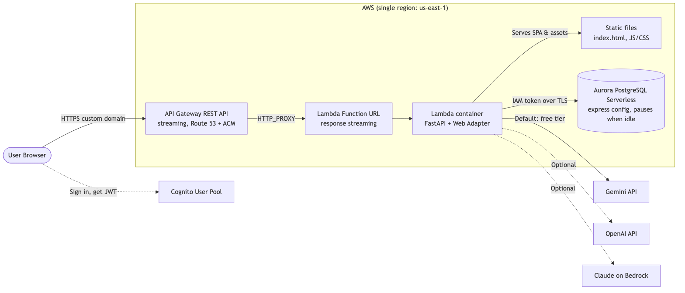
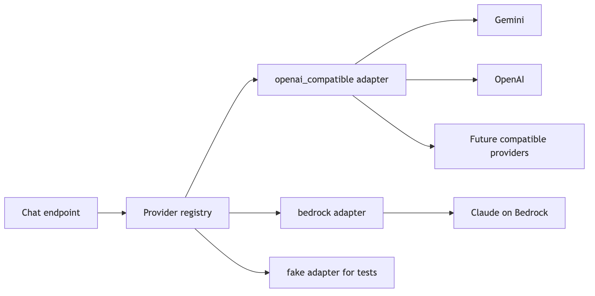
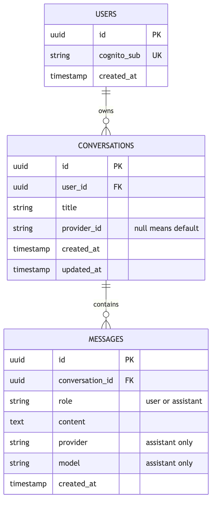
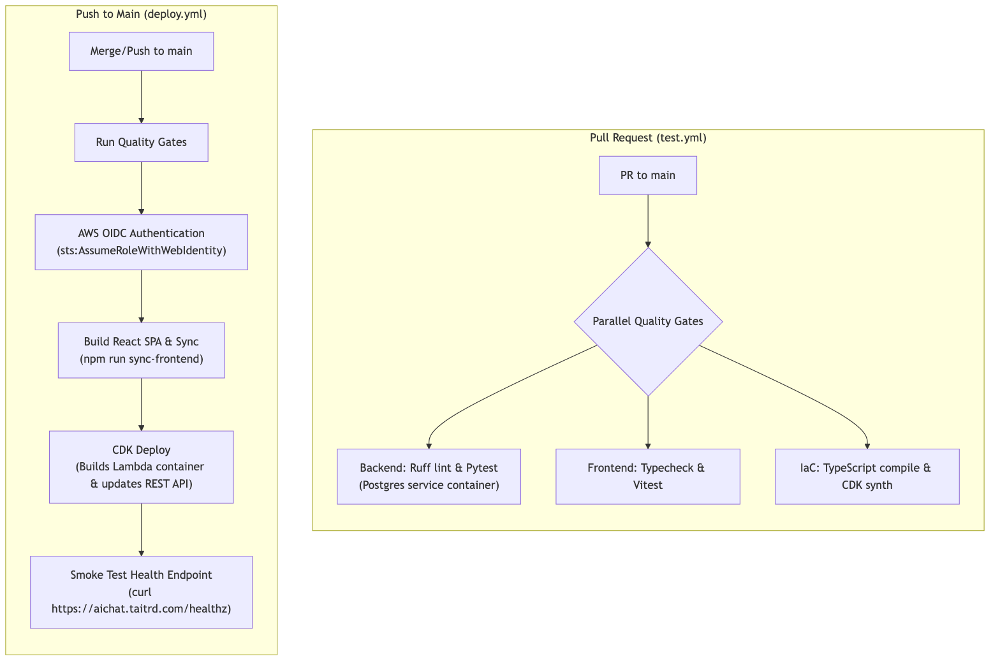
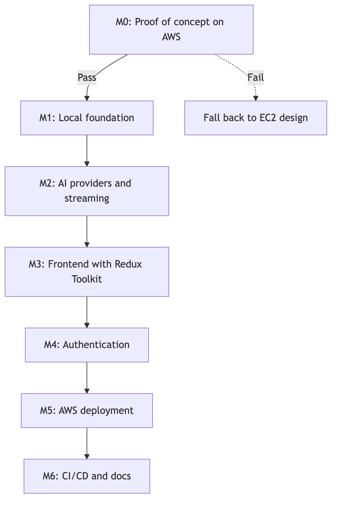

# Project Execution Plan: Lightweight AI Chat Application

Goal: a small, maintainable AI chat app on AWS, delivered with tests, IaC, CI/CD, short docs, and a live HTTPS custom domain.

**Target for the demo: about $2/month on AWS at light use, and $0 for AI.** Compute and database scale to zero when idle, so you pay mainly when someone uses the app. The trade-off is a wait of about 15–30+ seconds on the first request after idle.

Guiding rule: pay only for what the demo needs, and keep later upgrades simple.

---

## 1. Requirements Coverage

### Functional

| Requirement | How it is met |
| :--- | :--- |
| **Chat interface** | The user sends a message and the backend streams a reply from the selected AI provider (Sections 4 and 5C). |
| **Conversation management** | REST endpoints to create, list, view, rename, and delete (Section 5B). |
| **Chat history** | Users, conversations, and messages are stored in PostgreSQL (Section 6). |
| **User authentication** | Cognito login. The API validates the JWT and scopes every query to the signed-in user (Section 5A). |
| **User experience** | Responsive layout, loading skeletons, error toasts with retry, token-by-token streaming, and a stop button (Section 5D). |

### Deliverables

| Deliverable | Location |
| :--- | :--- |
| Frontend, backend, tests | `frontend/`, `backend/` |
| IaC | `iac/` (AWS CDK) |
| CI/CD | `.github/workflows/` |
| Live URL with HTTPS | Route 53 + ACM + CloudFront, for example `https://chat.<your-domain>` |
| Short docs linked by relative path | `README.md` → `docs/*.md` (Section 8) |

---

## 2. Architecture



<sub>Source: [`plan-architecture.mmd`](docs/diagrams/plan-architecture.mmd)</sub>

- **Same origin:** CloudFront serves the frontend and `/api/*`, so no CORS configuration is needed.
- **No VPC:** Lambda runs outside a VPC, and Aurora's express configuration is reachable through its internet access gateway. This avoids NAT Gateway costs, and Lambda can reach the AI APIs directly.
- **Stable public URL:** Only CloudFront is advertised publicly, so the backend can move later without changing the URL.
- **AWS only:** The frontend, backend, database, auth, and DNS all run on AWS. External services are limited to the AI API and GitHub for source and CI/CD.

---

## 3. Technology Reference Choices

### Required stack

| Layer | Selected | Alternatives considered | Why this choice |
| :--- | :--- | :--- | :--- |
| **Frontend** | React 19, TypeScript, Vite, Tailwind CSS | Next.js (needs a server for SSR); CRA (no longer maintained) | A chat app sits behind a login, so it doesn't need SSR. A static build is free to host at this scale. |
| **Frontend state** | **Zustand** | Redux Toolkit (more boilerplate); TanStack Query (a second library for little gain here) | Stores, actions, and selectors work much like Redux with far less code. It also works with Redux DevTools. |
| **Frontend requests** | `fetch` streams, `react-markdown` | `EventSource` (GET only, no auth header) | `fetch` supports POST with an `Authorization` header. |
| **Backend** | Python 3.12, FastAPI, Uvicorn, Lambda Web Adapter | Mangum (no streaming); Flask; Django | The same FastAPI container runs locally, on Lambda, and on Fargate later. |
| **Data access** | SQLAlchemy 2 (async), asyncpg, Alembic | SQLModel; raw SQL | Mature, with versioned migrations and a pluggable connection step for IAM tokens. |
| **Database** | Aurora PostgreSQL Serverless, express configuration | RDS (always billed); Aurora DSQL (not full PostgreSQL behavior) | Real PostgreSQL that pauses when idle, with no VPC to manage. |
| **CI/CD** | GitHub Actions with AWS OIDC | CodePipeline; static AWS keys (less secure) | Required by the brief, and no long-lived credentials are stored. |
| **IaC** | AWS CDK (TypeScript) | Terraform; raw CloudFormation | Required by the brief. High-level constructs need very little code. |

### AWS services

| Need | Selected | Idle monthly cost | Why this choice |
| :--- | :--- | :--- | :--- |
| **Frontend hosting** | S3 + CloudFront | ~$0 | Fits within CloudFront's free allowance at demo traffic. |
| **Backend hosting** | Lambda + Function URL | $0 | The closest AWS match to Cloud Run. It scales to zero and supports streaming. |
| **Database** | Aurora Serverless, 0–1 ACU | Storage only | Compute stops while paused. |
| **Authentication** | Cognito User Pool, Essentials tier | $0 up to 10,000 monthly users | Cognito handles password storage, email verification, and token rotation. |
| **Secrets** | SSM Parameter Store SecureString | $0 | Holds AI keys. The database needs no stored password. |
| **DNS and TLS** | Route 53 + ACM | ~$0.50 | The public certificate is free and renews automatically. |

### Hosting comparison

| Option | Approx. monthly cost | Verdict | Reason |
| :--- | :--- | :--- | :--- |
| **Lambda + Aurora Serverless** | **~$2 at light use** | **Selected** | Closest to pay-as-you-go, with automated database backups. |
| EC2 with Docker Compose | ~$11.50 fixed | **Fallback** if M0 fails | No cold starts and a predictable bill, but you manage backups and patching. |
| Lambda + RDS | ~$15–20 | Rejected | RDS never pauses. A Lambda in a VPC can't reach Gemini without a NAT Gateway. |
| Fargate + ALB + RDS | ~$55 | Later stage | The right design for steady traffic, but too expensive for a demo. |

AWS closed App Runner to new customers on April 30, 2026, so it is not an option.

---

## 4. Multiple AI Providers

Gemini is the default because of its free tier. OpenAI and Claude are optional and activate when their credentials are present.

| Provider | Cost | Best for | Notes |
| :--- | :--- | :--- | :--- |
| **Gemini Flash** (default) | Free tier, with rate limits | Demo at $0 | Free-tier prompts may be used by Google to improve its products, so check Google's terms. Don't enter sensitive data. |
| **OpenAI** | Pay per token | Offering a familiar model | A ChatGPT subscription doesn't include API usage, and sources disagree on whether new accounts get a free API allowance. Needs its own API billing. |
| **Claude Haiku 5.5 on Bedrock** | $0.10 input and $0.50 output per million tokens | Low-cost paid option on AWS with no API key | About $0.50 for 1,000 typical messages. Check regional rates on the Bedrock pricing page. |

### Design



<sub>Source: [`llm-providers.mmd`](docs/diagrams/llm-providers.mmd)</sub>

Every adapter implements one small interface and returns the same events, so the chat endpoint never contains provider-specific code:

```python
class LLMProvider(Protocol):
    def stream(self, messages: list[ChatMessage], *, system: str,
               max_tokens: int) -> AsyncIterator[TextDelta | StreamEnd]: ...
```

Adapters also convert provider errors into one shared set: `RateLimited`, `AuthFailed`, `Refused`, and `Unavailable`.

**One SDK covers two providers.** Google documents an OpenAI-compatible Gemini endpoint with streaming, so the `openai` SDK serves both Gemini and OpenAI. Google recommends this route when advanced Gemini features aren't needed, which fits text chat. If it falls short during M2, a native Gemini adapter can be added behind the same interface.

Providers are defined in configuration, and models are never hardcoded in application logic:

```yaml
# backend/app/llm/providers.yaml
- id: gemini
  label: Gemini
  adapter: openai_compatible
  base_url: https://generativelanguage.googleapis.com/v1beta/openai/
  model_env: GEMINI_MODEL
  api_key_env: GEMINI_API_KEY
- id: openai
  label: ChatGPT
  adapter: openai_compatible
  base_url: https://api.openai.com/v1
  model_env: OPENAI_MODEL
  api_key_env: OPENAI_API_KEY
- id: claude
  label: Claude
  adapter: bedrock
  model_env: BEDROCK_MODEL_ID
```

### Behavior

- **Activation:** A provider appears only when its credentials are configured. Claude is switched on with `BEDROCK_ENABLED=true`, which also adds its IAM permission in CDK.
- **Default:** `LLM_DEFAULT=gemini`.
- **Selection:** `GET /api/v1/models` lists active providers. The UI shows a selector, hidden when only one is active, and the choice is saved per conversation.
- **Switching mid-conversation:** History is stored as plain role and text, so it works with any provider.
- **Fallback:** `LLM_FALLBACKS` is empty by default so that the app never spends money unexpectedly. When set, it retries the next provider on `RateLimited` or `Unavailable`, only before the first token is sent.
- **Rejected:** LiteLLM and LangChain. They add a large dependency for what is about 50 lines per adapter.

---

## 5. Functional Design

### A. Authentication and security

1. The React client signs up and logs in directly against Cognito, including email verification.
2. The client sends the Cognito **access token** as `Authorization: Bearer <token>`.
3. A FastAPI dependency checks the signature (cached JWKS), `exp`, `iss`, `client_id`, and `token_use=access`. **This happens before any database access**, so invalid traffic can't wake Aurora.
4. The `sub` claim identifies the user, and the user row is created on first request.
5. Every query filters by `user_id`. Another user's conversation returns `404`, so its existence isn't revealed.

For local development only, `AUTH_MODE=local` bypasses Cognito. The app refuses to start with this setting in production.

### B. API (`/api/v1`)

| Action | Endpoint |
| :--- | :--- |
| Create (default title `"New Chat"`) | `POST /conversations` |
| List (paginated, newest activity first) | `GET /conversations` |
| Rename or change provider | `PATCH /conversations/{id}` |
| Delete (cascades to messages) | `DELETE /conversations/{id}` |
| View messages | `GET /conversations/{id}/messages` |
| Send message and stream the reply | `POST /conversations/{id}/messages` |
| List active AI providers (no DB access) | `GET /models` |
| Health check (no auth, no DB access, not under `/api/v1`) | `GET /healthz` |

After the first message, the title is set to its first 60 characters. This avoids a second model call.

### C. Streaming flow (SSE)

1. Validate the request and check limits, save the user message, then close the DB connection.
2. Load the most recent 40 messages and send them to the selected provider, with no DB connection held during the stream.
3. Stream the reply to the browser:
   ```text
   data: {"delta": "Hello"}
   data: {"delta": " world"}
   data: {"stop_reason": "end_turn"}
   data: [DONE]
   ```
4. Save the reply with its provider and model **before** sending `[DONE]`, because Lambda can freeze once the response ends.
5. After streaming has started, a failure is sent as `event: error` rather than an HTTP error status.

**Stop button:** The browser cancels the request and keeps the partial text on screen. If Lambda detects the disconnect, the backend saves the partial text. If it doesn't (tested in M0), the provider call runs to completion within the limits below, and the saved reply may be longer than what the user saw.

**Lambda and CloudFront settings**

| Setting | Value | Why |
| :--- | :--- | :--- |
| Function URL | `RESPONSE_STREAM`, auth `NONE` | Enables streaming, while the app validates JWTs itself |
| `AWS_LWA_INVOKE_MODE` | `response_stream` | Must match the Function URL setting |
| Lambda memory and timeout | 512 MB, 5 minutes | Duration is billed for the whole stream |
| Internal reply deadline | 4 minutes 30 seconds | Saves the partial reply and ends cleanly before Lambda stops the function |
| Reserved concurrency | 10 | Caps concurrent requests, cost, and DB connections, at no charge |
| Backend heartbeat | SSE comment (`: ping`) every 15 seconds | Keeps the connection active while the model is thinking |
| CloudFront origin response timeout | 60 seconds | Leaves room for Aurora to resume |
| CloudFront `/api/*` behavior | All methods, `CACHING_DISABLED`, `ALL_VIEWER_EXCEPT_HOST_HEADER` | Forwards `Authorization`, while a Function URL needs its own `Host` value |
| CloudFront origin header | A random secret, checked by the app | Rejects requests that go directly to the Function URL |

**Claude adapter only**

- Use the Anthropic SDK's Bedrock Mantle client with `anthropic.claude-haiku-5-5` and the Lambda execution role.
- Set `output_config: {effort: "low"}` and forward only text deltas, because responses can begin with thinking blocks.
- Map `stop_reason: "refusal"` to the shared `Refused` error.

### D. Frontend and user experience

**Zustand stores**

| Store | Holds | Main actions |
| :--- | :--- | :--- |
| `authStore` | Current user and auth status | `signIn`, `signOut`, `getAccessToken` |
| `conversationStore` | Conversation list and active ID | `load`, `create`, `rename`, `remove`, `select` |
| `chatStore` | Messages by conversation, stream status, and errors | `loadMessages`, `send`, `stop` |
| `uiStore` | Sidebar state, toasts, provider list, and "waking up" status | `toggleSidebar`, `addToast`, `loadModels` |

**If you know Redux:** a slice becomes a store, a thunk becomes an async action, and `useSelector` becomes `useChatStore((s) => s.messages)`. No provider wrapper or action types are needed.

**Conventions**

- Keep API calls in `services/api.ts`, and call them from store actions.
- Use narrow selectors so a streaming message doesn't re-render the whole app.
- Batch incoming tokens once per animation frame instead of updating state for each token.
- Use the `devtools` middleware in development. Use `persist` for `uiStore` preferences and the browser cache in Section 5E.
- Leave auth tokens to the Cognito library rather than copying them into a store.

**User experience**

- **Layout:** Collapsible sidebar that becomes a drawer on mobile, a message feed with auto-scroll, and an auto-growing input.
- **Loading:** Skeletons for the conversation list and messages, plus a "thinking" indicator until the first token.
- **Cold start:** A "Waking up the demo, this can take up to 30 seconds…" message when the API is resuming, with automatic retries.
- **Errors:** Toasts with retry, a sign-in redirect on `401`, and a clear message when the free AI quota is used up.
- **Cancel:** A stop button that uses `AbortController`.
- **Rendering:** Markdown and code blocks with raw HTML disabled, which prevents XSS from model output.
- **Demo notice:** A short note not to enter sensitive information while the free AI tier is in use.

### E. Caching and Limits

Aurora bills for time awake, and it stays awake for at least 5 minutes after its last activity. A single request therefore costs about the same as a burst of requests, and the goal is to **avoid waking the database at all**.

**Browser cache (avoids database reads)**

- Zustand `persist` stores the conversation list and recently opened messages in IndexedDB, keyed by user.
- The app shows cached data immediately on load, with no database call and no cold-start wait.
- The list refreshes when it is more than 1 hour old, when the user presses refresh, or after the user changes something.
- Messages are fetched only if the conversation's `updated_at` is newer than the cached copy, or if there is no cached copy.
- The app doesn't poll or refresh on tab focus.
- The cache is cleared on sign-out, which protects shared devices.
- Another device's changes can take up to 1 hour to appear unless the user refreshes.

**Lambda memory cache:** JWKS keys and the `sub` to user ID mapping are reused while an instance is alive. Sending a message still writes to the database, so the saving is small.

**Not used**

- Caching AI replies, because prompts rarely repeat and it doesn't reduce database use.
- CloudFront caching of `/api/*`, because it could expose one user's private data to another.
- Redis or ElastiCache, because it would cost more than it saves.
- Delayed database writes, because a frozen Lambda could lose messages.

**Usage limits (protect AI quota and reduce activity)**

| Limit | Starting value | Stored in |
| :--- | :--- | :--- |
| Message length | 4,000 characters | Request validation |
| Reply length | `max_tokens` 8,000 | Provider request |
| Messages per user | 30 per day | PostgreSQL, checked when saving the message |
| Messages across all users | 200 per day | PostgreSQL, checked when saving the message |
| Concurrent requests | 10 | Lambda reserved concurrency |

A reached limit returns `429` with a friendly message. For OpenAI, use prepaid credit with auto-recharge turned off, which caps spend.

**Daily awake cap (limits Aurora compute cost)**

Message limits don't fully control awake time, because a few requests spread across a day can keep the database awake for hours. A small guard Lambda provides the limit:

1. An EventBridge schedule runs it every 15 minutes. It reads CloudWatch metrics only, so it can't wake Aurora.
2. It counts today's minutes where `ServerlessDatabaseCapacity` is above 0.
3. Above `AWAKE_CAP_HOURS` (3 hours per UTC day), it sets the API Lambda's reserved concurrency to 0. Aurora then pauses after its idle timeout.
4. On the first run of the next UTC day, it restores the concurrency to 10.

While paused, the frontend and cached conversations still load, and the UI shows "The demo has reached its daily limit and will be back tomorrow." Before an important demo, raise `AWAKE_CAP_HOURS` or run the documented override.

**Alerts:** An AWS Budgets alert at $5/month covers everything else. It reports only, and billing data can lag by hours.

---

## 6. Database Schema and Access (PostgreSQL)



<sub>Source: [`data-model.mmd`](docs/diagrams/data-model.mmd)</sub>

- **Indexes:** `conversations (user_id, updated_at DESC)` and `messages (conversation_id, created_at)`.
- **Delete behavior:** Foreign keys use `ON DELETE CASCADE`.

### Connection rules for Lambda and Aurora

| Rule | Why |
| :--- | :--- |
| **No connection pool (`NullPool`):** open per request and close immediately | Open connections from idle Lambdas can stop Aurora from pausing, and one idle connection could keep you paying for compute |
| **No database access in `/healthz` or `/models`** | Health checks and page loads shouldn't wake Aurora |
| **No scheduled pings or keep-warm jobs** | They would stop the database from pausing |
| **Short IAM tokens:** generate them in the connection step and reuse for about 10 minutes | Express configuration allows IAM auth only, and tokens last 15 minutes |
| **`DB_AUTH_MODE=iam` on AWS, `password` locally** | Local Docker PostgreSQL uses a normal password |
| **Retry during resume:** retry connections for up to 45 seconds, then return `503` with `Retry-After` | Aurora usually resumes in about 15 seconds, and 30 seconds or longer after a long pause. The frontend shows the waking message and retries. |

### Migrations and backups

- **Migrations:** The deploy workflow runs `alembic upgrade head` as a separate step before deploying new code. Lambda never migrates at startup.
- **Database users:** The admin user runs migrations. The app connects as a limited `app` user with the `rds_iam` role.
- **Backups:** Aurora automated backups with 7-day retention and point-in-time restore. A restore is tested during M5 and documented in `docs/deployment.md`.
- **Accidental deletion:** Deletion protection is on, and the CDK resource uses a retain policy.

---

## 7. Cost, Security, and Scalability

### Estimated monthly cost (`us-east-1`, light demo use)

Assumes about 20 hours of database activity per month, including the 5-minute wait before each pause.

| Item | Estimate |
| :--- | :--- |
| Aurora compute (20 hours at about 0.5 ACU) | ~$1.20 |
| Aurora storage and I/O (about 1 GB) | ~$0.15 |
| Route 53 hosted zone | $0.50 |
| ECR, S3 | ~$0.10 |
| Lambda, CloudFront, Cognito, SSM, ACM | $0 at demo usage |
| Gemini API free tier | $0 |
| **Total** | **~$2/month, plus the yearly domain fee** |

- **Lambda allowance:** The free tier includes 1 million requests per month. Compute is also included up to a monthly limit of GB-seconds, which should be confirmed on the pricing page. A 30-second reply at 512 MB uses 15 GB-seconds.
- **Estimates:** The Aurora rates and the GB-second allowance are from memory, so confirm them in the AWS Pricing Calculator.
- **New AWS accounts:** Credits of $100–$200 and an Aurora free tier may reduce this further. Check the terms in the billing console.

**The main cost risk is Aurora staying awake,** which would cost about $44 for a full month at 0.5 ACU. Cost depends on awake time rather than the number of users or queries: each isolated visit costs about $0.005 for its 5 minutes, and users active at the same moment share that cost.

| Scenario | Awake time | Aurora compute per month |
| :--- | :--- | :--- |
| Light demo use | 20 hours per month | ~$1.20 |
| Daily awake cap reached every day | About 3.25 hours per day, including up to 15 minutes before the guard's next check | ~$6 at 0.5 ACU, ~$12 at the 1 ACU maximum |
| No cap, awake all month | 730 hours | ~$44 at 0.5 ACU, ~$88 at 1 ACU |

The cap keeps Aurora compute near or below the $11.50 EC2 option in the worst case. If you regularly reach it, that's the signal to move to a later growth stage.

### What is given up to reach this price

| Decision | Benefit | What is given up | Change it when |
| :--- | :--- | :--- | :--- |
| Aurora pauses when idle | Almost no idle compute cost | About 15–30+ seconds on the first request after idle | Waiting is no longer acceptable |
| Express configuration with no VPC | No NAT Gateway, no networking setup | The internet gateway can't be disabled, and there's no RDS Proxy, custom KMS key, or custom parameter group | Compliance or tuning requires them |
| Lambda instead of always-on containers | $0 when idle | Cold starts, a 15-minute maximum, and one active request per instance | Traffic becomes steady |
| Gemini free tier | No token costs | Rate limits, and prompts may be used by Google | Limits are hit, or privacy matters |
| Daily awake cap | A firm limit on Aurora compute cost | The chat stops for everyone until the next UTC day once the cap is reached | Real users depend on it |
| Browser cache | Fewer database wakes, and instant page loads | Other devices' changes can take up to 1 hour to appear | Multi-device freshness matters |

### Growth path

The app code and URL stay the same at every stage. The container runs on Lambda or Fargate, with the Web Adapter active only on Lambda.

| Stage | Change | What to do | Approx. monthly AWS cost |
| :--- | :--- | :--- | :--- |
| **0. Demo** | This plan | Scale to zero | **~$2** |
| **1. More users** | Raise concurrency and max ACU | CDK values only, with Aurora still pausing | Usage based |
| **2. No database wait** | Minimum 0.5 ACU | One CDK value | ~$45+ |
| **3. Steady traffic** | Fargate + ALB, Aurora or RDS in a VPC | Same image, migrate with `pg_dump` and restore, point CloudFront at the ALB | ~$55–100 |
| **4. Production hardening** | Multi-AZ, Redis for limits, staging | Add as needed | $150+ |

Add AI costs at any stage according to the provider used. Express clusters can't be attached to a VPC, so Stage 3 needs a data migration. Raise the daily awake cap at Stage 1, and remove the guard Lambda at Stage 2 because the database no longer pauses.

**Rules that keep upgrades simple**

- Configuration comes only from environment variables and Parameter Store.
- The API keeps no local state. Limits and history live in PostgreSQL.
- All schema changes go through Alembic.
- CloudFront stays the only advertised entry point.

### Security

- **Database:** IAM auth only over TLS, with no password to leak. The endpoint is reachable from the internet, so access depends on IAM rather than network isolation. Storage is encrypted with an AWS-managed key.
- **API access:** JWT validation on protected routes, plus the CloudFront origin header to reject direct Function URL traffic. The public Function URL is the main exposure, so these two checks must stay in place.
- **Encryption:** HTTPS from the browser to CloudFront, from CloudFront to Lambda, and from Lambda to Aurora and the AI providers. S3 is encrypted at rest.
- **Secrets:** AI keys and the origin header value live in Parameter Store or CDK-managed configuration, and never in the repository or image.
- **IAM:** The Lambda role allows only `rds-db:connect` for the `app` user and reads from its parameter path, plus Bedrock invoke when enabled. GitHub deploys through an OIDC role limited to this repository's `main` branch.
- **S3:** Private, and reachable only through CloudFront Origin Access Control.
- **Application:** Per-user data scoping, input validation, parameterized SQL, and security headers set by CloudFront.

### Scalability

| Layer | Demo capacity | First limit to expect | Next step |
| :--- | :--- | :--- | :--- |
| Frontend | CloudFront scales automatically | None at this size | None needed |
| Backend | 10 concurrent requests, set deliberately | Reserved concurrency | Raise the value, up to the account quota |
| Database | 1 ACU maximum (about 2 GiB) | Connections and CPU | Raise max ACU |
| AI | Provider rate limits | Gemini free quota | Enable paid billing or another provider |

---

## 8. Repository Structure

```text
├── .github/workflows/
│   ├── test.yml                 # PR: lint, type-check, test, cdk synth
│   └── deploy.yml               # main: test, migrate, deploy, smoke test
├── backend/
│   ├── app/
│   │   ├── api/v1/chat.py       # Conversation, message, models, and SSE endpoints
│   │   ├── core/config.py       # Pydantic Settings
│   │   ├── core/security.py     # Cognito JWT and origin header checks
│   │   ├── db/models.py         # SQLAlchemy models
│   │   ├── db/session.py        # NullPool engine, IAM tokens, resume retries
│   │   ├── llm/
│   │   │   ├── base.py          # Interface, events, shared errors
│   │   │   ├── registry.py      # Loads providers.yaml, activates by credentials
│   │   │   ├── providers.yaml
│   │   │   ├── openai_compatible.py  # Gemini, OpenAI
│   │   │   ├── bedrock.py       # Claude
│   │   │   └── fake.py          # Tests and offline development
│   │   └── main.py
│   ├── alembic/
│   ├── scripts/migrate.sh       # alembic upgrade head, with IAM auth for prod
│   ├── tests/
│   ├── Dockerfile               # FastAPI image with Lambda Web Adapter
│   └── requirements.txt
├── frontend/
│   ├── src/
│   │   ├── components/          # Sidebar, ChatFeed, MessageInput, ModelSelect, AuthForm
│   │   ├── stores/              # authStore, conversationStore, chatStore, uiStore
│   │   ├── services/api.ts      # REST and SSE stream client
│   │   ├── services/cache.ts    # IndexedDB storage for Zustand persist
│   │   └── App.tsx
│   ├── tests/
│   └── package.json
├── iac/
│   ├── bin/app.ts
│   ├── lib/
│   │   ├── auth-stack.ts        # Cognito User Pool and client
│   │   ├── data-stack.ts        # Aurora express cluster, retained
│   │   ├── api-stack.ts         # Lambda image, Function URL, IAM, awake guard
│   │   ├── web-stack.ts         # S3, CloudFront, ACM, DNS, config.json
│   │   └── cicd-stack.ts        # GitHub OIDC provider and deploy role
│   ├── lambda/awake-guard.py    # Daily awake cap, about 30 lines
│   └── package.json
├── docs/
│   ├── architecture.md
│   ├── local-setup.md
│   ├── deployment.md
│   └── design-decisions.md
├── docker-compose.yml           # Local: PostgreSQL, FastAPI, Vite dev server
├── .env.example
└── README.md
```

### Documentation (short and easy to read)

| File | Length | Contents |
| :--- | :--- | :--- |
| `README.md` | 1 page | Overview, live URL, CI badge, cold-start note, and relative links to the docs below |
| `docs/architecture.md` | 1 page | Architecture diagram, request and streaming flow, security boundaries |
| `docs/local-setup.md` | 1 page | Three steps with `docker compose up`, environment variables, tests, using `fake` with no API key |
| `docs/deployment.md` | 1 page | Prerequisites, domain setup, `cdk deploy --all`, AI keys, GitHub OIDC, backup and restore |
| `docs/design-decisions.md` | 1 page | Hosting, SSE vs. WebSockets, providers, Zustand, caching and limits, cost table |

The docs are written ahead of the code and say so at the top. Update them as each milestone finishes, especially `deployment.md` after M0 and M5.

---

## 9. Testing and CI/CD

### Tests

| Area | Tooling | Key cases |
| :--- | :--- | :--- |
| Backend | `pytest`, `httpx`, Postgres service container, `fake` provider | CRUD, cascade delete, **user isolation**, invalid tokens, origin header check, SSE order, save before `[DONE]`, reply deadline, limits |
| Database layer | `pytest` | IAM token refresh, connection closed after each request, retries then `503` during resume, no DB access in `/healthz` or `/models` |
| AI adapters | `pytest` with mocked HTTP responses | Same event order and error mapping for each provider, activation by credentials, fallback only before the first token |
| Frontend | Vitest, React Testing Library | Store actions, SSE parsing, token batching, stop button, waking and paused messages, cache hits with no API call, cache cleared on sign-out, model selector, error and loading states |
| Awake guard | `pytest` with mocked AWS calls | Pauses above the cap, restores on a new UTC day, never touches the database |
| IaC | `cdk synth`, CDK assertions | Streaming Function URL, reserved concurrency, retained Aurora cluster, private S3, guard allowed to change only the API Lambda |
| Live | `curl` smoke test after deploy | HTTPS response from the custom domain and `/healthz`, plus one manual streamed chat at release |

CI never calls real AI APIs, so test runs use no quota and cost nothing.

### Pipelines



<sub>Source: [`ci-pipeline.mmd`](docs/diagrams/ci-pipeline.mmd)</sub>

- **Authentication:** GitHub Actions assumes an AWS role through OIDC, with no stored AWS keys.
- **Deployment:** Lambda switches to the new version as part of the deploy, so there's no server to restart. Requests already running finish on the old version.
- **First deploy:** Create the data stack before running migrations, because the cluster must exist first.
- **Rollback:** Redeploy the previous commit.
- **Migration safety:** Keep migrations backward compatible, because they run before the new code is live.

---

## 10. Implementation Milestones



<sub>Source: [`milestones.mmd`](docs/diagrams/milestones.mmd)</sub>

| Milestone | Scope | Done when |
| :--- | :--- | :--- |
| **M0: Proof of concept (half a day)** | Minimal FastAPI on Lambda, CloudFront, and an express cluster. Delete it or reuse it afterward. | All M0 checks below pass |
| **M1: Local foundation (Day 1)** | Docker Compose, models, Alembic, conversation CRUD, backend tests | CRUD tests pass against PostgreSQL |
| **M2: AI providers and streaming (Day 1–2)** | Provider interface and registry, `fake` and Gemini, SSE endpoint, heartbeat, limits. OpenAI and Bedrock adapters. | A real Gemini reply streams through `curl`, and adding a key makes another provider active with no code change |
| **M3: Frontend (Day 2–3)** | Zustand stores, responsive layout, sidebar actions, streaming, model selector, loading, error, and waking states | The full chat flow works locally on desktop and mobile widths |
| **M4: Authentication (Day 3)** | Cognito pool, login and signup UI, JWT validation, user scoping | Two test users can't see each other's data |
| **M5: AWS deployment (Day 4)** | CDK stacks, custom domain, HTTPS, migrations, backup restore | The live URL works, Aurora pauses when idle and resumes on use, a test with a low cap stops and restores the API, and a backup restores successfully |
| **M6: CI/CD and docs (Day 5)** | Both workflows, OIDC role, README, and docs | A merge to `main` deploys automatically, and the docs work from a clean checkout |

### M0 checks

The design depends on these, and they should be confirmed before building the app:

| # | Check | Pass when | If it fails |
| :--- | :--- | :--- | :--- |
| 1 | Express cluster can pause | Minimum capacity of 0 is accepted, and the instance pauses when idle | Use the EC2 fallback |
| 2 | Lambda connects with IAM tokens | SQLAlchemy and asyncpg work through the internet access gateway | Use the EC2 fallback |
| 3 | Closed connections allow pausing | Aurora pauses after Lambda requests stop | Fix the connection handling, or use the EC2 fallback |
| 4 | Resume experience | The first request succeeds within the retry window | Tune the retries and UI |
| 5 | Streaming | SSE arrives token by token through CloudFront, including a reply longer than 2 minutes | Tune the settings, or use the EC2 fallback |
| 6 | Stop behavior | The result of a client disconnect on Lambda is recorded | Keep the documented fallback in Section 5C |
| 7 | CDK support | Express clusters can be created with CDK, using a custom resource if needed | Create the cluster with one documented CLI step |

---

## 11. Prerequisites and Items to Verify

**Needed from you**

| Item | When | Cost |
| :--- | :--- | :--- |
| AWS account | M0 | A few dollars at most for the proof of concept |
| Gemini API key from Google AI Studio | M2 | Free |
| Domain, registered in or delegated to Route 53 | M5 | Yearly fee, which varies by domain ending |
| GitHub repository | M6 | Free |
| OpenAI API key with prepaid credit | Optional | Pay per token |

**Verify during the build**

| Item | When | Why |
| :--- | :--- | :--- |
| Current Gemini free-tier models, limits, data terms, and regional availability | M2 | Third-party sources conflict, so use Google's pricing page and terms. Set `GEMINI_MODEL` from what your account offers. |
| Streaming through Gemini's OpenAI-compatible endpoint | M2 | Google documents it, but older forum reports describe problems. The fallback is a native adapter. |
| Claude: async Mantle client and exact IAM action | When Claude is enabled | The guidance checked confirms only the sync client, and AWS sources differ on the IAM action name. |
| `ServerlessDatabaseCapacity` reports 0 while paused | M0 | The daily awake cap counts minutes from this metric. |
| How the frontend sees a Lambda with concurrency 0 | M5 | The paused message depends on recognizing the throttled response through CloudFront. |
| Aurora and Lambda prices and free tiers | M5 | The Aurora rates and GB-second allowance here are from memory, so confirm them in the AWS Pricing Calculator. |

**Out of scope for now:** file uploads, tool use, web search, shared conversations, multi-region deployment, and a staging environment.

---

## 12. References

- [Aurora express configuration](https://docs.aws.amazon.com/AmazonRDS/latest/AuroraUserGuide/CHAP_GettingStartedAurora.AuroraPostgreSQL.ExpressConfig.html)
- [Aurora automatic pause and resume](https://docs.aws.amazon.com/AmazonRDS/latest/AuroraUserGuide/aurora-serverless-v2-auto-pause.html)
- [AWS Lambda Web Adapter](https://github.com/aws/aws-lambda-web-adapter)
- [Lambda response streaming](https://docs.aws.amazon.com/lambda/latest/dg/configuration-response-streaming.html)
- [AWS Lambda pricing](https://aws.amazon.com/lambda/pricing/)
- [Amazon Aurora pricing](https://aws.amazon.com/rds/aurora/pricing/)
- [Gemini API pricing](https://ai.google.dev/gemini-api/docs/pricing)
- [Gemini OpenAI compatibility](https://ai.google.dev/gemini-api/docs/openai)
- [OpenAI API pricing](https://openai.com/api/pricing/)
- [Amazon Bedrock pricing](https://aws.amazon.com/bedrock/pricing/)
- [Amazon Cognito pricing](https://aws.amazon.com/cognito/pricing/)
- [Zustand documentation](https://zustand.docs.pmnd.rs/)
