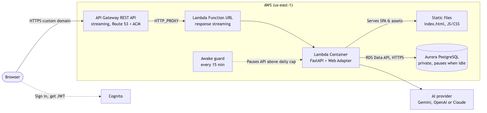
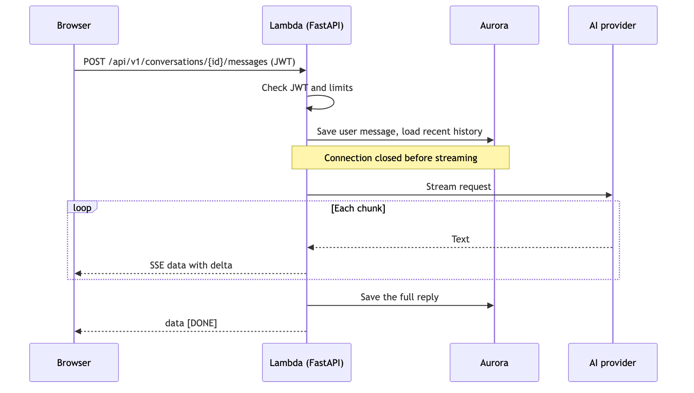
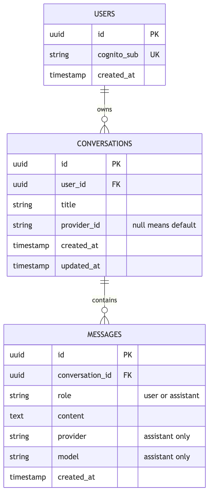

# Architecture

[← Back to README](../README.md)

> Describes the planned design. See [`PLAN.md`](../PLAN.md) for details.

## Overview

Source: [`architecture.mmd`](diagrams/architecture.mmd)

| Part            | Job                                                                                                                                                         |
| :-------------- | :---------------------------------------------------------------------------------------------------------------------------------------------------------- |
| **API Gateway** | The single public entry point: a REST API with response streaming, so replies arrive token by token. It has the custom domain and Route 53 alias, and proxies every request to the Lambda Function URL.                       |
| **Lambda**      | Runs the FastAPI container with AWS Lambda Web Adapter. Serves both the React SPA (static assets) and the `/api/v1/*` backend, scaling to zero when unused. |
| **Aurora**      | Stores users, conversations and messages. It pauses after 5 idle minutes.                                                                                   |
| **Cognito**     | Handles sign-up, sign-in and tokens.                                                                                                                        |
| **AI provider** | Generates replies. Gemini is the default, and others are enabled by configuration.                                                                          |
| **Awake guard** | A small scheduled Lambda that limits how long Aurora runs each day.                                                                                         |

## Request flows

### Opening the app

1. API Gateway routes traffic to FastAPI, which serves the pre-bundled React SPA (`index.html` and static assets).
2. The app shows conversations cached in the browser right away.
3. It calls the API only if the cache is missing or more than 1 hour old, which keeps the database asleep when possible.

### Sending a message

Source: [`send-message.mmd`](diagrams/send-message.mmd)

- **Waking the database:** if Aurora is paused, the API retries for up to 45 seconds while it resumes. The browser shows a "waking up" message.
- **Heartbeat:** a ping every 15 seconds keeps the HTTP connection alive during quiet periods.
- **Save order:** the reply is saved before `[DONE]` is sent, because Lambda can freeze once the response ends.

## Security

| Boundary               | Protection                                                                                                                                                |
| :--------------------- | :-------------------------------------------------------------------------------------------------------------------------------------------------------- |
| Browser to API Gateway | HTTPS only, with an ACM certificate on the custom domain                                                                                                  |
| API Gateway to Lambda  | HTTPS proxy to the streaming Lambda Function URL                                                                                                          |
| Every API request      | Cognito JWT checked before any database access                                                                                                            |
| User data              | Every query is filtered by the signed-in user. Another user's chat returns `404`.                                                                         |
| Lambda to Aurora       | RDS Data API over HTTPS, signed with the Lambda's IAM role. The database has no public IP or open ports, and Lambda can read only the `app_data` secret. |
| Secrets                | AI keys are kept in SSM Parameter Store, never in code or images                                                                                          |
| GitHub to AWS          | OIDC role limited to this repository's `main` branch, with no stored AWS keys                                                                             |
| Cost                   | Message limits, a daily cap on database awake time, and a budget alert                                                                                    |

## Data model

Source: [`data-model.mmd`](diagrams/data-model.mmd)

Deleting a conversation also deletes its messages.
